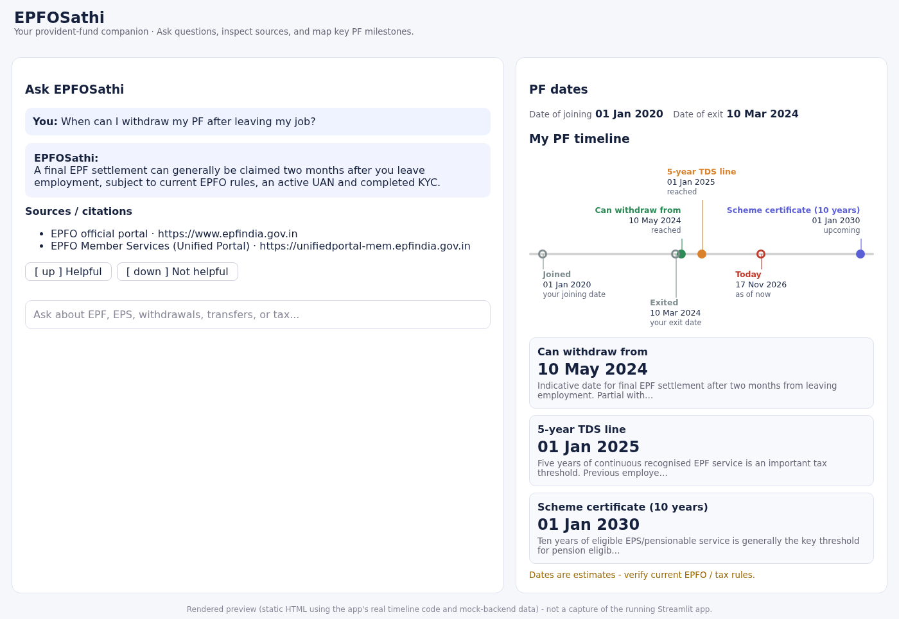
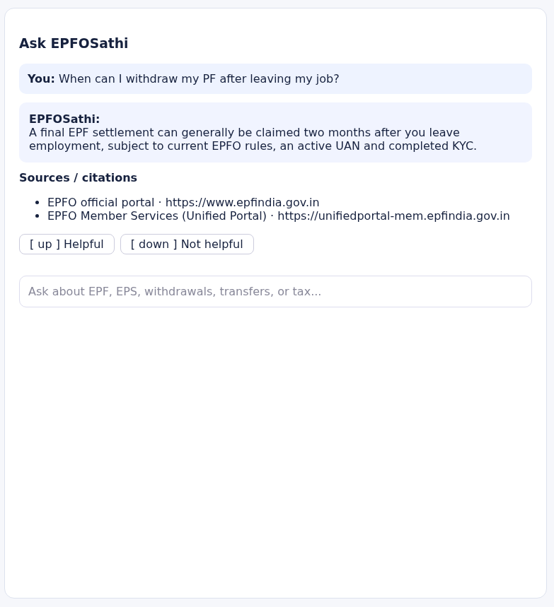
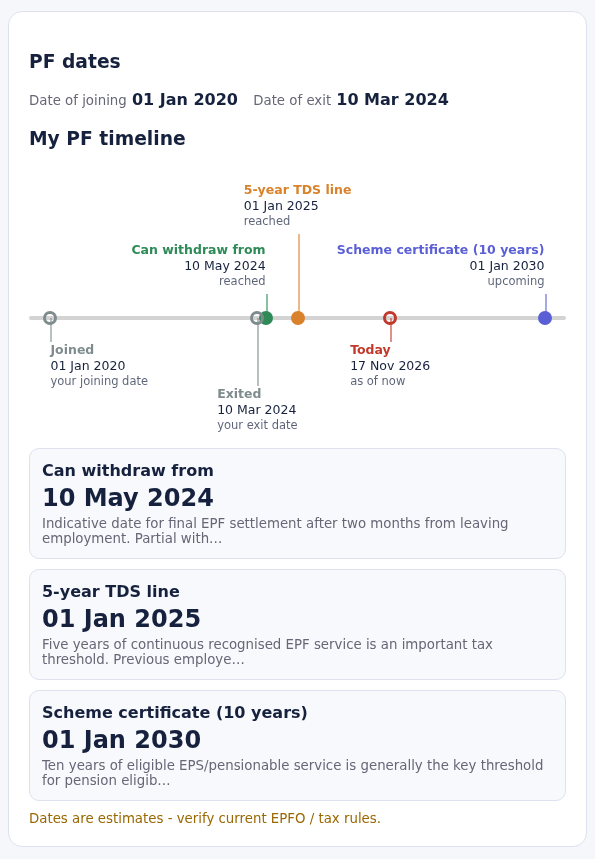

# EPFOSathi — Checkpoint 2

A Streamlit chat interface for EPFOSathi with the requested **My PF timeline** signature feature.

## Checkpoint 2 deliverables

- Chat UI calls `POST /ask` or `POST /agent` on the configured backend.
- Answers display source citations when the API returns them.
- 👍 / 👎 feedback is saved locally in SQLite; each answer can be rated once.
- **My PF timeline** calculates and displays the requested markers from joining and optional exit dates:
  - **Can withdraw from** — indicative exit date + two calendar months.
  - **5-year TDS line** — joining date + five calendar years.
  - **Scheme certificate (10 years)** — joining date + ten calendar years.
- Local mock backend provides repeatable demo responses without requiring a live EPFO API.
- Demo mode pre-fills sample dates so the full timeline can be shown consistently.

## Screenshots and visual demo evidence

The images below are **browser-rendered demo previews** created with Chromium from the project's real PF timeline calculation and local mock-backend response. They are designed to look like a polished application walkthrough, but they are **not screenshots of a running Streamlit session**. The footer in the full preview identifies this clearly. Use the live-capture steps further below to produce genuine Streamlit browser evidence on a machine where the app dependencies are installed.

### Full application walkthrough



### Chat, answer, citations and feedback controls



### My PF timeline and milestone cards



### Genuine live Streamlit screenshot

After starting the demo, run `python scripts/capture_screenshot.py`. The script writes `screenshots/checkpoint-2-live.png`. This file is only created when the capture script successfully connects to the running Streamlit app; the rendered previews above are not substituted for it.

## Quick start — Windows

1. Install Python 3.10 or newer.
2. Extract this project folder.
3. Open the folder and double-click `START_DEMO.bat` (or use the commands below).
4. Open [http://localhost:8501](http://localhost:8501) if the browser does not open automatically.

The launcher installs `requirements.txt` when needed, starts the local mock API on port `8000`, and starts Streamlit on port `8501`. Keep the terminal window open while demonstrating. Press `Ctrl+C` to stop the demo.

## Quick start — terminal

```powershell
python -m venv .venv
.venv\Scripts\Activate.ps1
python -m pip install -r requirements.txt
python run_demo.py
```

Open [http://localhost:8501](http://localhost:8501). The mock API is available at `http://localhost:8000`; its health endpoint is `http://localhost:8000/health`.

### Demo walkthrough

Open this URL to prefill sample dates for the demo:

[http://localhost:8501/?demo=1](http://localhost:8501/?demo=1)

Sample dates:

| Field | Value |
|---|---|
| Date of joining | 01 Jan 2020 |
| Date of exit | 10 Mar 2024 |
| Can withdraw from | 10 May 2024 |
| 5-year TDS line | 01 Jan 2025 |
| Scheme certificate (10 years) | 01 Jan 2030 |

Demonstrate these actions:

1. Ask: `When can I withdraw my PF after leaving my job?` Show the response and citations.
2. Switch the sidebar route to `agent` and ask: `Is TDS applicable for me?`.
3. Click 👍 on one response and 👎 on another. Confirm the saved-feedback message.
4. Show My PF timeline and all three milestone markers.
5. Untick `I have left this employment`, rebuild the timeline, and show joining-only milestones.
6. Optionally stop the mock API and demonstrate the friendly connection-error message.

More detailed steps are in [DEMO.md](DEMO.md).

## Capture a genuine live screenshot

Install the optional browser-capture dependency and Chromium once:

```powershell
python -m pip install -r requirements-capture.txt
python -m playwright install chromium
```

With the app running in another terminal, execute:

```powershell
python scripts/capture_screenshot.py
```

This opens the running Streamlit app in demo mode, submits a sample PF question, waits for the answer, and saves `screenshots/checkpoint-2-live.png`. If the browser cannot connect, first start the app with `python run_demo.py`.

## Optional video recording (Windows)

With the demo visible, press `Windows + Alt + R` to start Xbox Game Bar recording. Demonstrate chat, citations, both API routes, feedback, and the timeline. Press `Windows + Alt + R` again to stop. Windows normally saves the clip under `Videos\Captures`. This recording is optional unless your evaluator specifically requests it.

## Use the real EPFOSathi backend

The default launcher uses the local mock backend; its answers are canned demo responses and are **not live EPFO determinations**. To connect the actual EPFOSathi API, set the backend base URL and token as appropriate, then start only the UI:

```powershell
$env:EPFOSATHI_API_URL = "http://localhost:8000"
$env:EPFOSATHI_API_TOKEN = ""
python run_demo.py --no-mock
```

Select `ask` or `agent` in the Streamlit sidebar. The app appends the selected route to the base URL.

## Project layout

| Path | Purpose |
|---|---|
| `ui/app.py` | Streamlit chat, citations, feedback, PF timeline |
| `ui/api_client.py` | Backend requests, response/citation normalisation, SQLite feedback |
| `ui/pf_timeline.py` | Pure date calculations for the three markers |
| `ui/timeline_view.py` | Responsive horizontal timeline renderer |
| `mock_backend/server.py` | Local `/health`, `/ask`, and `/agent` demo API |
| `run_demo.py` | Starts the mock backend and Streamlit together |
| `scripts/capture_screenshot.py` | Captures a real screenshot from a running Streamlit session |
| `scripts/render_preview.py` | Creates a labelled static preview without Streamlit |
| `screenshots/` | Browser-rendered demo previews and (after capture) genuine live Streamlit evidence |
| `tests/` | Automated tests |

## Timeline interpretation and limitations

These markers are informational estimates, not a legal, tax, or EPFO eligibility decision. The final-settlement marker is shown as exit date + two calendar months; partial advances and exceptions may differ. The five-year tax test depends on continuous recognised EPF service and may include transferred service from previous employers. Ten years of eligible EPS/pensionable service is generally the important pension threshold; Scheme Certificate handling depends on age, service, and exit circumstances. Verify current rules and personal service history with EPFO or a qualified adviser.

Month-end dates are clamped to the last day of the target month; leap-day anniversaries are clamped to 28 February in non-leap years. Exit dates before joining dates are rejected.

## Tests

Run from the project root:

```powershell
python -m pytest -q
```

The test suite covers date arithmetic, marker ordering and validation, timeline rendering, API payload/auth construction, citation extraction, feedback persistence, mock `/ask` and `/agent` routes, and the mock health endpoint.

## Checkpoint 2 Git tag

After the **actual live screenshot** is captured and committed:

```powershell
git add README.md DEMO.md START_DEMO.bat run_demo.py ui/app.py mock_backend/server.py scripts/capture_screenshot.py screenshots requirements-capture.txt tests
git commit -m "Complete Checkpoint 2 live demo evidence"
git tag -fa checkpoint-2 -m "Checkpoint 2 live demo"
git show checkpoint-2 --stat
```

If pushing to GitHub, confirm the branch name first (`git branch --show-current`), then push that branch and the updated tag. Only force-push the tag if it is safe to replace the existing remote tag.
