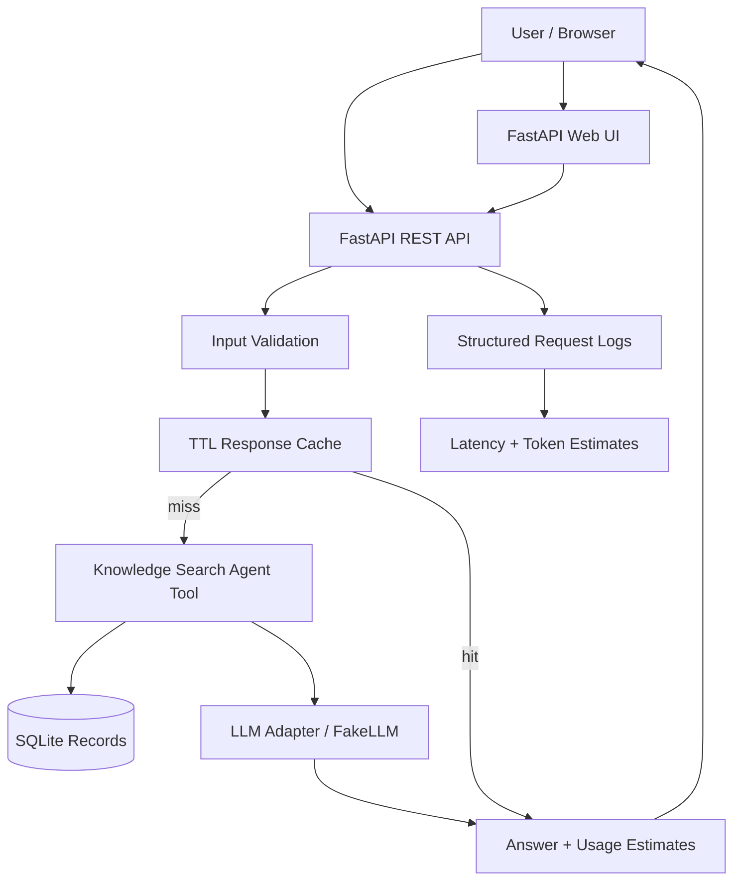

# EPFOSathi

[](https://github.com/Vaibhav12312/Genrative-Ai-Agentic-Ai-/actions/workflows/ci.yml)

**EPFOSathi is a lightweight, safety-conscious assistant for understanding general Employees' Provident Fund (EPF/EPFO) topics.** It combines a searchable knowledge-record store, a simple question-answer endpoint, and a browser demo. It is an educational prototype, not an official EPFO service and cannot access member accounts or submit claims.

## The problem

People often need quick explanations of common EPFO terms and processes, but information can be scattered across pages and written in unfamiliar language. EPFOSathi provides one simple place to ask general questions and search a small curated knowledge base. It explicitly sends account-specific actions to official EPFO channels rather than pretending to access private member data.

## What it does

- FastAPI endpoints for health, knowledge records, search, and question answering.
- SQLite-backed records with parameterized SQL queries.
- A small browser UI at `/` and interactive API documentation at `/docs`.
- Request latency logs and estimated input/output token counts for each `/ask` request.
- A 128-entry, 60-second in-process LRU/TTL response cache.
- Validated input limits: 4,000 characters per question, 160 per record title, 8,000 per record body, and 200 per search query.
- Prompt-injection-aware system policy and a regression test for an injection attempt.
- Docker Compose startup and GitHub Actions quality checks.

## Architecture



## Quick start (local)

Python 3.11+ is recommended.

```bash
python -m venv .venv
# Windows PowerShell: .venv\Scripts\Activate.ps1
# macOS/Linux: source .venv/bin/activate
pip install -r requirements.txt
uvicorn app.main:app --reload
```

Open:

- Browser demo: http://127.0.0.1:8000/
- API docs: http://127.0.0.1:8000/docs
- Health check: http://127.0.0.1:8000/health

## Run with Docker

Docker Desktop (or Docker Engine with the Compose plugin) is required.

```bash
docker compose up --build
```

Then open http://localhost:8000. SQLite data is persisted in the named `epfosathi_data` volume. Stop with `Ctrl+C`; run `docker compose down` to remove the container. To also delete persisted data, use `docker compose down -v`.

## API examples

Create a knowledge record:

```bash
curl -X POST http://localhost:8000/records \\
  -H "Content-Type: application/json" \\
  -d '{"title":"UAN basics","content":"UAN is a Universal Account Number.","category":"account"}'
```

Search records:

```bash
curl "http://localhost:8000/search?q=UAN"
```

Ask a question:

```bash
curl -X POST http://localhost:8000/ask \\
  -H "Content-Type: application/json" \\
  -d '{"question":"What is a UAN?"}'
```

The `/ask` response includes `answer`, `latency_ms`, `cache`, and `usage` (`input_tokens_est`, `output_tokens_est`, `total_tokens_est`). Token counts are rough character-based estimates for observability only, not tokenizer-accurate billing figures. The current `FakeLLM` is deterministic and runs locally without an external model API key.

## Tests and code quality

```bash
ruff check .
pytest -q
```

The suite covers health, record creation/listing, search, `/ask` with a fake LLM, response caching, input limits, the agent knowledge-search tool, prompt-injection regression behavior, latency headers, and a log-content check confirming `/ask` logs latency/token estimates without logging the raw question. CI runs Ruff, pytest, and a Docker image build on pushes and pull requests to `main`/`master`.

## Production notes

The following are **configured limits and design parameters**, not claims of a load test or production SLA:

| Area | Current setting | Operational note |
|---|---:|---|
| Maximum question size | 4,000 characters | Requests above this are rejected with HTTP 422 |
| Record title | 160 characters | Validated before database writes |
| Record content | 8,000 characters | Validated before database writes |
| Record category | 80 characters | Validated before database writes |
| Search query | 200 characters | Validated at the API boundary |
| Response cache | 128 entries | In-process LRU eviction |
| Cache TTL | 60 seconds | Expired responses are recomputed |
| Request metrics | Every HTTP request | Structured JSON log includes method, path, status, latency in ms |
| Ask metrics | Every `/ask` request | Structured JSON log includes latency and estimated input/output/total tokens, plus cache hit/miss |
| Token measurement | Approx. 1 token per 4 characters | Lightweight estimate; replace with the selected model tokenizer for billing/accurate usage |
| Persistence | SQLite volume | Suitable for a small demo; use managed PostgreSQL for multi-instance production |

**Before real production use:** replace `FakeLLM` with a vetted provider adapter; use provider tokenization and timeout/retry controls; add authentication, authorization, rate limiting, secrets management, PII-safe log filtering, backups, monitoring/alerts, and security review. The in-memory cache is per process and is not shared across replicas. Review all EPFO guidance against current official sources. Do not log member identifiers or sensitive personal data.

#demo link:-
project (video) demo link :- https://drive.google.com/file/d/1TLlCmmMhTeZ15gxRO18b-DME10CvzldQ/view?usp=sharing
project link :- https://epfosathi-latest-1.onrender.com/

## Results

| Check | Result in this delivery |
|---|---|
| Automated test cases | **13 passed** in the build environment (`pytest -q`) |
| Ruff | Checked locally by the project owner |
| Docker | Docker build checked locally by the project owner |
| Git repository status | Checked locally by the project owner |
| API + browser UI | FastAPI app, `/`, `/docs`, `/health`, `/records`, `/search`, `/ask` |
| Observability + cache | Latency/token-estimate logs and 128-entry/60-second cache implemented |
| Input limits + injection test | API validation limits and prompt-injection regression test included |

No throughput, latency benchmark, hosted deployment, or live demo recording is claimed by this repository. Add measured values after running a repeatable benchmark and publishing the demo.

## Project structure

```text
EPFOSathi/
├── .github/workflows/ci.yml
├── app/
│   ├── services/{cache.py,llm.py}
│   ├── agent.py
│   ├── database.py
│   └── main.py
├── docs/resume.md
├── tests/{conftest.py,test_api.py}
├── .dockerignore
├── Dockerfile
├── docker-compose.yml
├── pyproject.toml
└── requirements.txt
```

## License

Add the license required by your submission or organization before public distribution.
