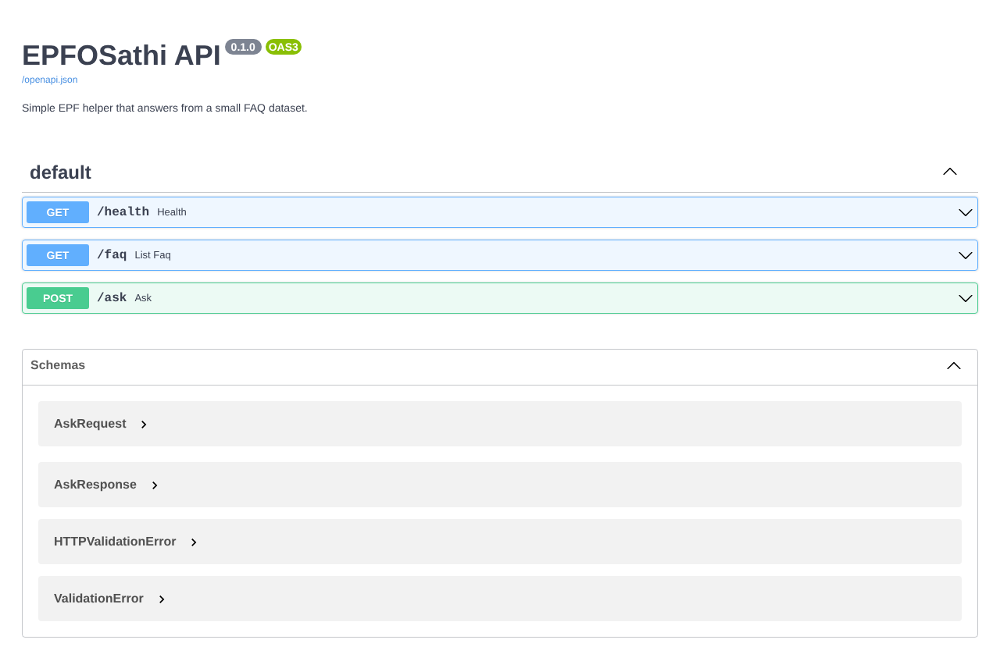

# Checkpoint 1

## 1. Run the FastAPI app
```bash
python -m venv .venv
source .venv/bin/activate        # Windows: .venv\Scripts\activate
pip install -r requirements.txt
uvicorn app.main:app --reload
```
Open **http://127.0.0.1:8000/docs** (Swagger UI). Try `POST /ask` with
`{"question": "How do I activate my UAN?"}`.

**Evidence of a real run:** `docs/run_output.txt` (/docs returns HTTP 200, /health ok, all 10 questions sent to /ask).



*Swagger UI at `/docs` showing GET /health, GET /faq and POST /ask.*

## 2. One function explained: `find_best_answer`
Located in `app/main.py`.

- **Input:** the user's question as text.
- **What it does:** every FAQ entry has a list of keywords. The function lowercases the question,
  splits it into words, and counts how many of an entry's keywords appear. The entry with the
  highest count is the best match.
- **Output:** that entry, or `None` if no keyword matched.
- **Why `None` matters:** the `/ask` endpoint turns `None` into "I don't have this in my EPFO
  data" rather than inventing an answer. This is the rule that makes Q6 safe.
- **Original FAQs:** if no curated entry matches, `/ask` calls a second function,
  `find_original_faq`, which searches the 20 original EPFO FAQ records in
  `app/data/epfo_faq_records.py` and returns the answer with its `source_url`.
- **Limitation:** it is keyword matching, not understanding; a rephrased question with none
  of the keywords will miss. Later checkpoints can improve this.

## 3. Tag
```bash
git tag checkpoint-1
git push origin checkpoint-1
```
