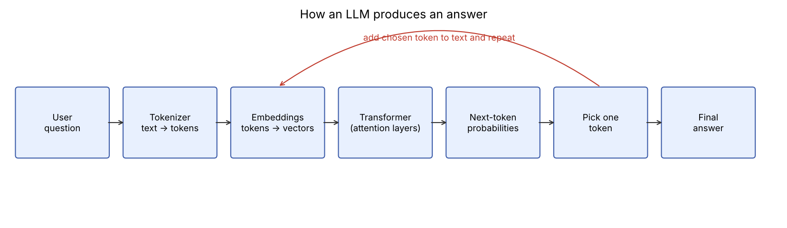
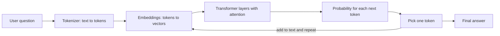

# How LLMs Work (in my own words)

A large language model (LLM) is a program that has read an enormous amount of text and learned
one skill: **guess the next piece of text**. Everything else it appears to do (answering,
summarising, translating) comes from doing that one guess over and over.

## The steps, in plain language

1. **Tokenization.** The model can't read letters directly. My sentence is chopped into small
   chunks called *tokens* (a word, part of a word, or punctuation) and each token becomes a number.
2. **Embeddings.** Each token number is turned into a long list of numbers (a vector) that
   captures its meaning. Words used in similar ways end up with similar vectors.
3. **Attention (the transformer).** Many layers let every token "look at" the other tokens in the
   prompt and decide which ones matter. In "The bank approved my *loan*", attention helps "bank"
   understand it means money, not a river.
4. **Probabilities for the next token.** At the end, the model gives a score to every possible
   next token, e.g. "PF" 40%, "UAN" 20%, and so on.
5. **Pick and repeat.** One token is chosen, added to the text, and the whole process runs again
   until the answer is finished.

(Same diagram as text, renders on GitHub:)

## How it learns

- **Pre-training:** the model reads huge amounts of text and is repeatedly asked to predict the
  next token. When it is wrong, its internal numbers (weights) are nudged to be a bit less wrong.
- **Fine-tuning / human feedback:** it is then trained on good example conversations so it
  behaves like a helpful assistant instead of just continuing random text.

## Why this matters for EPFOSathi

- An LLM does **not look anything up**. It produces text that *sounds* right, so it can state a
  wrong PF rule or a wrong portal link very confidently (this is called a hallucination).
- Its knowledge stops at its training date, so it can't know new EPFO circulars.
- It knows nothing about a particular person's account.
- That is why EPFOSathi answers from a **fixed, checked data file** and says "I don't have this"
  when the data has no answer, instead of guessing.
